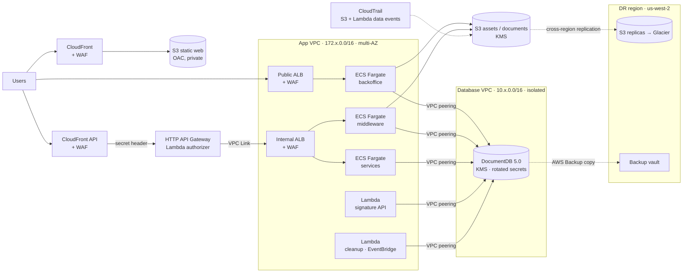

# AWS CDK Secure Platform

A production-grade, security-first AWS platform written in **AWS CDK (JavaScript)**. One config file per environment deploys the whole thing: networking, containers, database, edge security, API, storage, audit and cross-region backup.

I designed this architecture for insurance platforms sold through banking channels, where every layer has to pass a bank's security review. Swap the values in `config/` and it deploys for any client.

   

## Architecture



## What it builds

| Stack | What it does |
| --- | --- |
| `vpcEnv` / `vpcDb` / `peering` | Two VPCs: one for workloads, one isolated for data, joined by VPC peering with explicit routes. |
| `docdbDatabase` | DocumentDB 5.0 cluster encrypted with a customer-managed KMS key. Separate DB users for ECS and Lambda, each secret rotated automatically every 30 days. The KMS key itself rotates every 90 days. |
| `EcsStack` | ECS Fargate cluster with Container Insights, ECR repos, a **public** and an **internal** ALB, host-based routing, and autoscaling on CPU, memory and a day/night schedule. Services are declared in config, not code. |
| `WafStack` | **4 Web ACLs, 62 rules**: CloudFront, API CloudFront, public ALB and internal ALB. AWS managed rule groups (Common, SQLi, PHP, Linux, Known Bad Inputs, IP reputation, Anonymous IP, Admin protection), Bot Control, anti-DDoS rate limits, geo blocking, host allow lists, IP sets and WAF logging. |
| `ApiGatewayStack` | HTTP API with a Lambda authorizer, private integration to the internal ALB through a **VPC Link**, fronted by CloudFront. CloudFront injects a secret header so the API rejects traffic that skips the CDN. |
| `S3Buckets` / `S3DestinationStack` | Public assets, static web (served via CloudFront OAC) and private documents buckets, KMS-encrypted, with **cross-region replication** to a second region and lifecycle to Glacier. |
| `LambdaStack` | VPC-attached Lambdas with least-privilege access to DocumentDB and Secrets Manager, plus an EventBridge-scheduled cleanup job. |
| `CloudTrailStack` | Trail with management events and **data events** on S3 buckets and Lambda functions. |
| `BackupStack` / `BackupDestinationStack` | AWS Backup plan for DocumentDB: daily (28 days), weekly (8 weeks) and monthly (5 years), each copied to a vault in the DR region. |
| `certificate` | ACM wildcard certificate validated through Route 53. |

## Design decisions

- **Data lives in its own VPC.** The database VPC has no internet path; only the app VPC CIDR can reach it over peering. A compromised public subnet never sees the database network.
- **Nothing private is public.** The middleware sits behind an internal ALB. The only way in is CloudFront → WAF → API Gateway → VPC Link.
- **Defense in depth at the edge.** Each entry point has its own Web ACL tuned to what it serves, instead of one generic rule set.
- **Secrets are never static.** DB credentials live in Secrets Manager, are encrypted with the database KMS key and rotate on a schedule.
- **Recover from a region outage.** Backups and object data are copied to a second region automatically.
- **Same code, every environment.** Dev, QA, UAT and Prod differ only in their JSON config: CIDRs, sizing, desired counts and allowed IPs.

## Usage

```bash
npm install

# 1. Create your environment config
cp config/example.json config/prod.json   # edit domain, CIDRs, certificate ARN, services, allowed IPs

# 2. Preview
npx cdk synth --all -c config=prod

# 3. Deploy (first run: leave "replication" out of the config)
npx cdk deploy --all -c config=prod -c apiHeaderSecret=$(uuidgen)

# 4. Enable S3 replication: copy the KMS key ARNs from the S3DestinationStack outputs
#    into config/prod.json under "replication", then deploy S3Buckets again.
```

Run the tests (offline, no AWS account needed):

```bash
npx jest
```

## Project layout

```
bin/app.js            entry point, picks config/<name>.json
config/               one JSON file per environment
lib/platform.js       wires the 14 stacks together
lib/vpc/              app VPC, database VPC, peering
lib/database/         DocumentDB + KMS + rotated secrets
lib/environments/     ECS Fargate, ALBs, autoscaling
lib/waf/              Web ACLs and rules
lib/api-gateway/      HTTP API, Lambda authorizer, VPC Link
lib/buckets/          S3 buckets and DR replicas
lib/lambda/           serverless jobs
lib/cloudtrail/       audit trail
lib/backup/           AWS Backup plan and DR vault
test/                 jest assertions on the synthesized templates
```

## See also

[aws-cdk-ecs-postgres-platform](https://github.com/cfarez19/aws-cdk-ecs-postgres-platform): the same network model with RDS PostgreSQL 17, a TLS-only Valkey cache and config-driven ECS services.

## Author

**Catalina Farez** — AWS Cloud Architect (AWS Certified Solutions Architect – Associate).
I design, migrate and secure AWS platforms for fintech and insurance teams. Available for freelance work.
